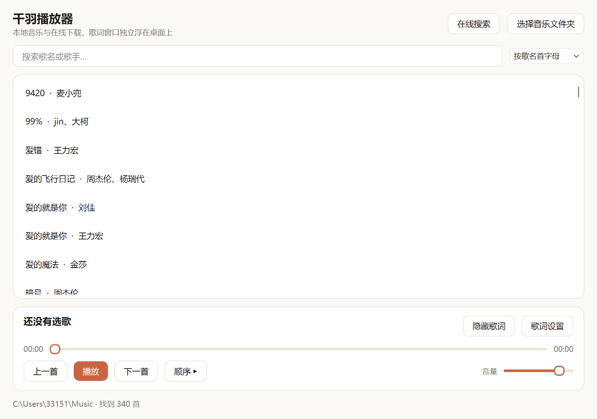
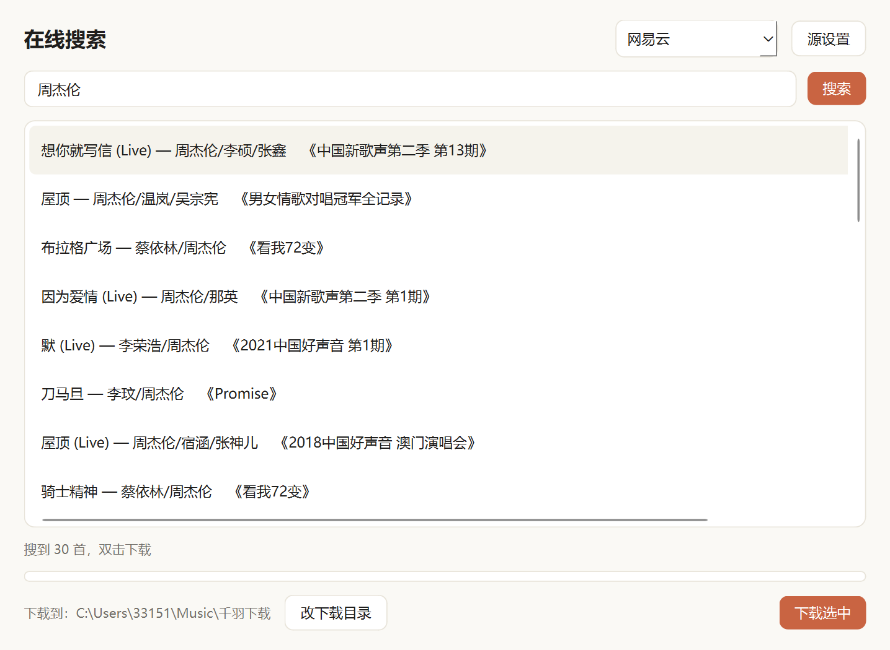

# 千羽播放器

> **本项目由 AI 制作，个人自用，不对外提供支持。**
>
> 代码由 [Capy](https://capy.ai)（Claude 驱动）按本人需求生成，需求、测试和取舍由本人把关。
> 仓库里的接口地址都是第三方公开服务，随时可能失效或限流，仅供自用参考，请勿用于商业用途。
> 下载和缓存的内容请自行确认版权归属。

本地音乐播放器，带一个独立浮在桌面上的大字号歌词窗口。播放和歌词由同一个进程控制，
进度精确到毫秒，歌词永远跟声音对得上。也能直接在网上搜歌、下载到本地。



## 下载

不想自己打包的话，到 [Releases](https://github.com/qianyufanyan/qianyu-player/releases/latest) 下现成的：

- **便携版** `qianyu-player-v1.0.0-portable.zip`（119 MB）—— 解压后双击里面的 `千羽播放器.exe` 直接用。不写注册表、不建快捷方式，删掉文件夹就算卸载，适合放 U 盘。
- **安装程序** `qianyu-player-v1.0.0-setup.exe`（163 MB）—— 双击安装到 `%LOCALAPPDATA%\千羽播放器`，建桌面和开始菜单快捷方式，带卸载项。

两个都是 Windows 10/11 x64，机器上不用装 Python。

## 安装

拿到 `千羽播放器-安装程序.exe` 后双击：

单文件安装包，启动时会把 120 MB 的运行时解压到临时目录，**第一次双击要等 20～40 秒才出窗口**，
不是卡死。出来之后：

1. 选安装位置（默认 `C:\Users\<你>\AppData\Local\千羽播放器`）
2. 勾选要不要建桌面快捷方式、开始菜单项
3. 点「开始安装」，十几秒装完，装完自动启动

安装包里只有一个 `千羽播放器.exe`，歌词窗口是它的一部分，不是另一个程序。

卸载：开始菜单 → 千羽播放器 → 右键「卸载」，或者直接跑安装目录里的 `卸载.bat`，
也可以在「设置 → 应用 → 已安装的应用」里找到「千羽播放器」。

## 本地音乐

默认扫描 `C:\Users\<你>\Music`，界面上「选择音乐文件夹」可以换目录。

- 文件名按「歌名-歌手」解析（酷狗下载下来的就是这个格式），用来匹配歌词
- 同名 `.lrc` 优先用本地文件，没有就走网络歌词接口
- 支持 mp3 / flac / wav / m4a / aac / ogg / wma / ape
- 搜索框过滤，右侧可以按歌名首字母或歌手首字母排序
- 音量、上次播到的歌、音乐目录都会记住

双击歌名播放。

## 在线搜索与下载

点顶栏「在线搜索」。



1. 选源（内置「网易云」），输入歌名或歌手，回车或点「搜索」
2. 列表里每条是「歌名 — 歌手 《专辑》」
3. 选中后点「下载选中」或者直接双击
4. 下载完歌和歌词（`.lrc`）一起落到下载目录，默认 `Music\千羽下载`，可以「改下载目录」换位置

下完的歌曲会自动出现在主界面列表里，直接双击就能播，歌词是同步的。

搜索不区分翻唱和原唱，看歌手和专辑自己挑；下载失败一般是那首歌下架或要会员，
换一条结果试试。

## 配置自己的网络源

「在线搜索」右上角 →「源设置」。

- **内置源**：网易云，走 GD Studio 的公开接口，开箱可用
- **新增**：起个名字，选协议，填地址
- **协议**：
  - `GD Studio 协议` —— 地址形如 `https://music-api.gdstudio.xyz/api.php`，源参数填 `netease` / `tencent` 之类
  - `Meting 协议` —— 地址形如 `https://你的域名/api`，源参数填 `netease` / `kugou` / 你服务支持的平台
- 改完点「应用修改」，返回搜索界面就能在源下拉里选到

自建 Meting 服务（GitHub 上 `metowolf/Meting-API`）或者别的公开实例，只要能按这两种协议返回
JSON，填进来就能用。删错了点「恢复内置源」。

## 歌词窗口

歌词窗口是独立的无边框窗口，默认浮在桌面底部。

- 拖动：按住窗口拖到任意位置，位置会记住
- 滚轮：在窗口上滚，字号跟着变
- 右键：弹出菜单，可以切单行 / 双排 / 三行、放大缩小字号、隐藏窗口
- 双击：全屏 / 退出全屏

全屏时自动开启鼠标穿透，不影响你操作别的程序。

### 快捷键

| 按键 | 作用 |
| --- | --- |
| `空格` | 播放 / 暂停 |
| `←` / `→` | 进度后退 / 前进 5 秒 |
| `↑` / `↓` | 上一首 / 下一首 |
| `Ctrl+Alt+↑` / `↓` | 歌词字号放大 / 缩小 |
| `Ctrl+Alt+F` | 歌词全屏 / 窗口切换 |
| `Ctrl+Alt+L` | 锁定歌词窗口（锁定后鼠标穿透） |
| `Ctrl+Alt+H` | 显示 / 隐藏歌词窗口 |
| `F11` | 歌词全屏切换 |

播放器里点「设置」可以调歌词的字体、字号、配色主题、描边、背景深浅、显示行数等，改完立刻生效。

## 常见问题

**双击安装包没反应** —— 在解压，等半分钟。任务管理器里能看到进程在跑就是在解压。

**搜不到歌** —— 先确认能上网，再检查「源设置」里的地址是否有拼错。公开接口偶尔会被限流，过一会儿再试。

**下载失败，提示没给出播放地址** —— 那首歌在这个源上要会员或已下架，换一条结果。

**下下来的文件名有点怪** —— 文件名里的 `/ : * ?` 这些 Windows 不允许的字符会被换成空格，可能留下多余的空格或点号，不影响播放。

**找不到歌词** —— 本地没有 `.lrc` 且网络歌词接口也没匹配到（小众歌、纯音乐、电台节目）。歌词窗口会显示「没找到歌词：歌名」。

**歌词窗口点不动了** —— 按了 `Ctrl+Alt+L` 锁定，再按一次解锁。

## 文件说明

```
player.py            播放器主程序
lyric_display.py     歌词窗口、歌词下载、设置面板（被 player.py 复用）
qianyu_online.py     在线搜索、下载、网络源配置
assets/qianyu.ico    程序图标
tools/smtc_bridge.ps1 读系统媒体会话的小脚本
build.spec           PyInstaller 打包配置：产出 dist/千羽播放器/
installer.py         安装程序源码：产出 dist/千羽播放器-安装程序.exe
install.bat          装依赖（PySide6、pypinyin、requests）
```

## 自己打包

```
python -m venv venv
venv\Scripts\python.exe -m pip install PySide6 pypinyin requests pyinstaller
```

产出程序目录：

```
venv\Scripts\python.exe -m PyInstaller --noconfirm --clean build.spec
```

然后把 `dist\千羽播放器\` 压成 `dist\payload.zip`（zip 根目录就是该目录的内容），再打安装包：

```
venv\Scripts\python.exe -m PyInstaller --noconfirm --clean --windowed --onefile ^
  --name "千羽播放器-安装程序" ^
  --add-data "dist/payload.zip;." ^
  --add-data "assets/qianyu.ico;assets" ^
  --icon "assets/qianyu.ico" ^
  --exclude-module tkinter --exclude-module unittest --exclude-module pydoc ^
  --exclude-module PySide6.QtMultimedia --exclude-module PySide6.QtNetwork ^
  --exclude-module PySide6.QtQml --exclude-module PySide6.QtQuick ^
  --exclude-module PySide6.QtSql --exclude-module PySide6.QtTest --exclude-module PIL ^
  installer.py
```

不打包直接跑源码：

```
venv\Scripts\python.exe player.py
```
